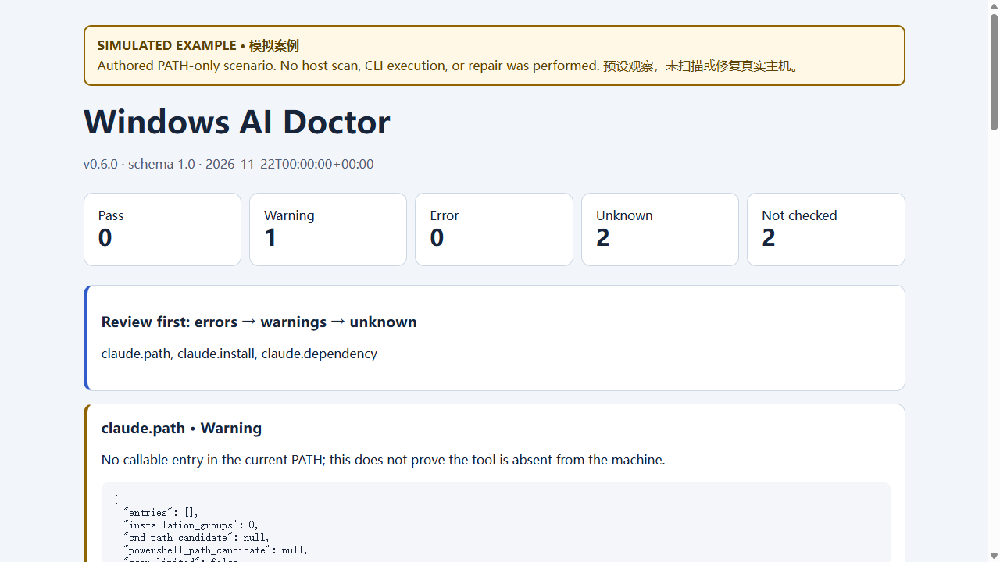

# Windows AI Doctor

**Claude Code or Codex won't run on Windows? Inspect PATH, installation groups, and launcher clues in a local report.**

[中文](README.zh.md) · v0.7.0 · Python 3.11+ · Windows-first · MIT

[](https://github.com/matchben3-commits/windows-ai-doctor/actions/workflows/windows.yml)
[](https://github.com/matchben3-commits/windows-ai-doctor/releases)
[](LICENSE)

[**Live demo**](https://matchben3-commits.github.io/windows-ai-doctor/) · [Sample report](https://matchben3-commits.github.io/windows-ai-doctor/report-en.html) · [Discussions](https://github.com/matchben3-commits/windows-ai-doctor/discussions) · [Release notes](https://github.com/matchben3-commits/windows-ai-doctor/releases/tag/v0.7.0)



Claude Code works in PowerShell but not in the shell an agent spawns. `codex` is installed twice, once through npm and once through the native installer, and PATH picks the older one. The command exists, but the process that needs it cannot see it.

Windows AI Doctor inspects the layers that usually break: PATH and PATHEXT resolution, duplicate installation groups, launcher runtime, config syntax, and Windows/WSL visibility. It writes a redacted report in Chinese or English, as Markdown, JSON, or a single offline HTML file.

It is read-only: no installs, upgrades, repairs, logins, or model API calls.

The screenshot and online walkthrough use **SIMULATED** observations, not a real user incident. [Step-by-step troubleshooting](docs/articles/windows-cli-path.en.md).

## Quick start

```powershell
python -m venv .wad-env
.\.wad-env\Scripts\python.exe -m pip install https://github.com/matchben3-commits/windows-ai-doctor/releases/download/v0.7.0/windows_ai_doctor-0.7.0-py3-none-any.whl
.\.wad-env\Scripts\python.exe -m windows_ai_doctor --no-version --lang en --format all --output-dir .\reports\first
Start-Process .\reports\first\report.en.html
```

This quick start uses `--no-version` to skip execution of installed CLI and Node programs. Omit it to include supported version probes; those probes are bounded but are not a full security or network sandbox.

Prefer not to install anything? Download the [source ZIP](https://github.com/matchben3-commits/windows-ai-doctor/releases/download/v0.7.0/windows-ai-doctor-v0.7.0-source.zip), extract it, and run `python .\doctor.py --lang en --format all --output-dir .\reports\first` from the extracted folder.

Use a Python 3.11+ distribution that includes pip (and venv for the isolated tutorial). The runtime uses the standard library; there are no third-party packages and no model keys. The wheel is not on PyPI yet; use the attached wheel and verify it against `SHA256SUMS.txt` on the release page.

## What it checks

| Layer | What you get |
| --- | --- |
| PATH / PATHEXT | PATH/PATHEXT candidates visible to this process, plus installation groups (for example, npm global vs native installer) |
| Launcher runtime | Native or Node, and whether the Node version satisfies the package's engine range |
| Config | Syntax and root shape of recognized config files; values are never printed |
| WSL | External clues only. Distributions are never started or entered |
| Baseline | `--baseline` compares two runs; `--fail-on regression` / `new` exit 1 on fixed regressions or added error/warn (excluding scan-limited paths) |

The report shows `pass`, `warn`, `error`, `unknown`, and `skipped`, and puts errors first. Every finding explains what was observed, why it matters, what to check manually, and what the check does not prove.

## What it does not do

- It does not install, upgrade, repair, or sign in to anything.
- Reports exclude credentials, chat history, config values, and raw command output. Syntax parsing reads recognized config files locally.
- It does not search the whole disk. Absence from PATH does not prove absence of an installation.
- It does not call a model API or upload a report anywhere.

## Why not just `claude doctor`?

[`claude doctor`](https://code.claude.com/docs/en/setup#verify-your-installation) provides installation and configuration diagnostics for Claude Code. Windows AI Doctor adds local Windows observations across Claude Code and Codex:

- two installations of the same CLI, with PATH pointing at the older one;
- the same command resolving differently in PowerShell, VS Code, and an agent's shell;
- a Node runtime that one launcher sees and another does not;
- a redacted report you can attach to an issue, and a baseline diff after a manual fix.

Run command lookup in the terminal that fails, then use the report to preserve observations and compare a later run. PATH inspection does not resolve PowerShell aliases or functions, and a report does not prove that an agent or editor inherits the same environment.

## Reading the report

1. Start with `error`, then `warn`, then `unknown`.
2. Open the finding that matches your symptom (usually `<tool>.path` for "command not found").
3. Run the suggested manual command in the same shell that fails. On Windows, `Get-Command claude,codex -All` is usually the first step.
4. Change one thing at a time, open a new terminal, and rerun with `--baseline` to see what actually changed.
5. `unknown` and `skipped` are not failures, and a `pass` only covers the check that ran.

## Common commands

```powershell
# Full report: Markdown + JSON + offline HTML
.\.wad-env\Scripts\python.exe -m windows_ai_doctor --lang en --format all --output-dir .\reports\first

# Only one tool, skip version probes
.\.wad-env\Scripts\python.exe -m windows_ai_doctor --tools claude --no-version --lang en

# Add a project config layer (explicit path, no parent traversal)
.\.wad-env\Scripts\python.exe -m windows_ai_doctor --project "D:\work\my-project" --lang en

# Compare before and after a fix
.\.wad-env\Scripts\python.exe -m windows_ai_doctor --baseline .\reports\first\report.en.json --fail-on regression --format all --output-dir .\reports\after

# Exit 1 only on new error/warn versus baseline (CI-friendly)
.\.wad-env\Scripts\python.exe -m windows_ai_doctor --baseline .\reports\first\report.en.json --fail-on new --format junit --output-dir .\reports\junit

# Other outputs
.\.wad-env\Scripts\python.exe -m windows_ai_doctor --format csv
.\.wad-env\Scripts\python.exe -m windows_ai_doctor --format sarif --output-dir .\reports\sarif
.\.wad-env\Scripts\python.exe -m windows_ai_doctor --format junit
.\.wad-env\Scripts\python.exe -m windows_ai_doctor --catalog --format json
```

Exit codes: `0` completed, `1` a selected failure state occurred, `2` argument/export failure, `130` interrupted. See the [v0.7 contract](docs/v07-contract.md) for the full rules.

## Privacy

The report uses opaque path references instead of real paths. It does not include config values, credentials, chat history, raw command output, or a machine identifier. Diagnostics run locally; no report is sent anywhere. WSL distributions are not started. See [docs/privacy.md](docs/privacy.md) for the exact boundary.

## Docs

- [v0.7 contract](docs/v07-contract.md) · [v0.6](docs/v06-contract.md) · [v0.5](docs/v05-contract.md) · [v0.4](docs/v04-contract.md)
- [Rules and probe boundaries](docs/rules.md)
- [Comparison and history](docs/comparison.md)
- [Changelog](CHANGELOG.md)

## Development

```powershell
python -B .\tests\run_tests.py
```

The suite covers the CLI, report formats, privacy boundaries, link/reparse-point cases, and packaging. Windows CI runs on Python 3.11 and 3.14. Contributions are welcome, especially real-world Windows failure reports that the current checks miss.

## License

MIT. Bundled third-party notices retain their original licenses.
