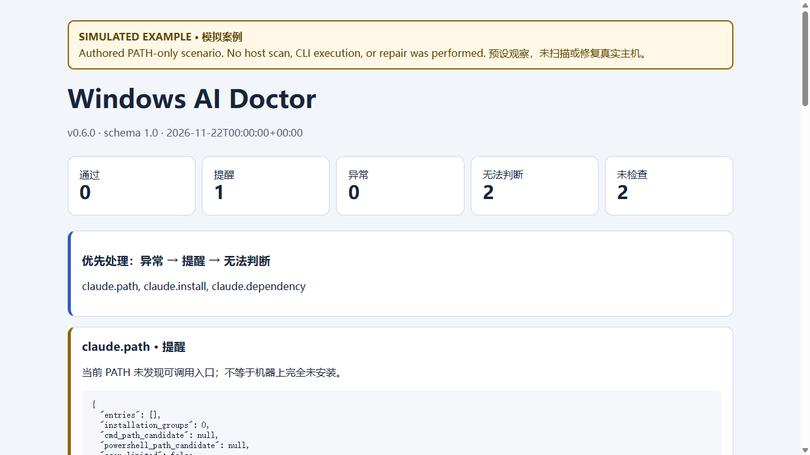

# Windows AI Doctor

**Claude Code / Codex 在 Windows 上跑不起来？用本地报告检查 PATH、安装组和启动入口。**

[English](README.md) · v0.7.0 · Python 3.11+ · Windows 优先 · MIT

[](https://github.com/matchben3-commits/windows-ai-doctor/actions/workflows/windows.yml)
[](https://github.com/matchben3-commits/windows-ai-doctor/releases)
[](LICENSE)

[**在线演示**](https://matchben3-commits.github.io/windows-ai-doctor/) · [示例报告](https://matchben3-commits.github.io/windows-ai-doctor/report-zh.html) · [Discussions](https://github.com/matchben3-commits/windows-ai-doctor/discussions) · [Release](https://github.com/matchben3-commits/windows-ai-doctor/releases/tag/v0.7.0)



PowerShell 里 `claude` 能跑，到了 agent 的 shell 里就 `command not found`；`where.exe claude` 出来两条，一条 npm 全局、一条原生安装，PATH 先命中的是旧的；命令明明在，调用它的进程却看不见。

Windows AI Doctor 检查最容易出问题的几层：PATH/PATHEXT 解析、重复安装组、启动器运行时（原生或 Node）、配置语法、Windows/WSL 可见性。输出中文或英文的脱敏报告，格式为 Markdown、JSON 或单文件离线 HTML。

只读：不安装、不升级、不修复、不登录、不调用模型 API。

截图和在线演示使用 **SIMULATED（模拟）** 数据，不是真实用户故障。[逐步排障教程](docs/articles/windows-cli-path.zh.md)。

## 快速开始

```powershell
python -m venv .wad-env
.\.wad-env\Scripts\python.exe -m pip install https://github.com/matchben3-commits/windows-ai-doctor/releases/download/v0.7.0/windows_ai_doctor-0.7.0-py3-none-any.whl
.\.wad-env\Scripts\python.exe -m windows_ai_doctor --no-version --lang zh --format all --output-dir .\reports\first
Start-Process .\reports\first\report.zh.html
```

这里用 `--no-version` 跳过已安装 CLI 和 Node 的执行。需要版本探测时可去掉该参数；版本探测有边界，但不是完整的安全或网络沙箱。

不想安装？下载[源码 ZIP](https://github.com/matchben3-commits/windows-ai-doctor/releases/download/v0.7.0/windows-ai-doctor-v0.7.0-source.zip)，解压后在目录里运行 `python .\doctor.py --lang zh --format all --output-dir .\reports\first`。

需要包含 pip 的 Python 3.11+ 发行版；隔离环境教程还需要 venv。运行时只用标准库，没有第三方依赖，也不需要模型密钥。wheel 还没上 PyPI，请用 Release 附件，并对照同页 `SHA256SUMS.txt` 校验。

## 它能查什么

| 层 | 你会看到什么 |
| --- | --- |
| PATH / PATHEXT | 当前进程 PATH/PATHEXT 中可见的候选入口；是否存在多个安装组（例如 npm 全局与原生安装并存） |
| 启动器运行时 | 原生还是 Node；Node 版本是否满足本地包声明的引擎范围 |
| 配置 | 已识别配置文件的语法和根结构；不打印任何配置值 |
| WSL | 只观察 Windows 侧的外部线索；不启动、不进入任何发行版 |
| 基线 | `--baseline` 对比两次诊断；`--fail-on regression` / `new` 在固定回归或相对基线新增的 error/warn（排除扫描受限 path）时退出 1 |

报告状态分为 `pass`、`warn`、`error`、`unknown`、`skipped`，异常排在前面。每条结论都会说明：观察到了什么、为什么值得看、建议手动检查什么、这项检查不能证明什么。

## 它不做什么

- 不安装、不升级、不修复、不登录任何账号。
- 不访问认证存储或聊天记录；配置语法分析会在本机内存中接触值，但报告不包含配置值或原始命令输出。
- 不扫描整块磁盘；PATH 里没有，不等于没安装。
- 不调用模型 API，也不上传报告。

## 和官方 doctor 的分工

[`claude doctor`](https://code.claude.com/docs/en/setup#verify-your-installation) 提供 Claude Code 的安装和配置诊断。Windows AI Doctor 补充 Claude Code 与 Codex 的 Windows 本地环境观察：

- 同一个 CLI 装了两份，PATH 指向旧的那份；
- 同一条命令在 PowerShell、VS Code、agent 的 shell 里解析结果不同；
- 一个启动器能看见 Node，另一个看不见；
- 一份可以贴进 issue 的脱敏报告，以及手动修完后用 baseline 对比“到底变了没有”。

在实际报错的终端里查命令，再保存报告、比较后续观察。PATH 检查不能代替 PowerShell 别名和函数解析，也不证明 agent 或编辑器继承了相同环境。

## 怎么读报告

1. 先看 `error`，再看 `warn`，最后看 `unknown`。
2. 找到和症状对应的那条，通常是“命令找不到”对应的 `<tool>.path`。
3. 在**真正报错的那个 shell** 里运行建议的手动命令。Windows 上第一步通常是 `Get-Command claude,codex -All`。
4. 一次只改一处，打开新终端，再用 `--baseline` 复跑，确认到底哪项变了。
5. `unknown` 和 `skipped` 不是故障；`pass` 也只代表这一项本次通过。

## 常用命令

```powershell
# 完整报告：Markdown + JSON + 离线 HTML
.\.wad-env\Scripts\python.exe -m windows_ai_doctor --lang zh --format all --output-dir .\reports\first

# 只查一个工具，跳过版本探测
.\.wad-env\Scripts\python.exe -m windows_ai_doctor --tools claude --no-version --lang zh

# 显式加入一个项目配置层（不向父目录遍历）
.\.wad-env\Scripts\python.exe -m windows_ai_doctor --project "D:\work\my-project" --lang zh

# 修完后对比前后
.\.wad-env\Scripts\python.exe -m windows_ai_doctor --baseline .\reports\first\report.zh.json --fail-on regression --format all --output-dir .\reports\after

# 仅在相对基线的新发现 error/warn 时退出 1（便于 CI）
.\.wad-env\Scripts\python.exe -m windows_ai_doctor --baseline .\reports\first\report.zh.json --fail-on new --format junit --output-dir .\reports\junit

# 其他输出
.\.wad-env\Scripts\python.exe -m windows_ai_doctor --format csv
.\.wad-env\Scripts\python.exe -m windows_ai_doctor --format sarif --output-dir .\reports\sarif
.\.wad-env\Scripts\python.exe -m windows_ai_doctor --format junit
.\.wad-env\Scripts\python.exe -m windows_ai_doctor --catalog --format json
```

退出码：`0` 完成，`1` 出现所选失败状态，`2` 参数/导出失败，`130` 中断。完整规则见 [v0.7 契约](docs/v07-contract.md)。

## 隐私

报告用路径代号代替真实路径，不包含配置值、凭据、聊天记录、原始命令输出或机器标识。诊断在本机完成，报告不会自动发送到任何地方。WSL 发行版不会被启动。完整边界见 [docs/privacy.md](docs/privacy.md)。

## 文档

- [v0.7 契约](docs/v07-contract.md) · [v0.6](docs/v06-contract.md) · [v0.5](docs/v05-contract.md) · [v0.4](docs/v04-contract.md)
- [规则依据与探测边界](docs/rules.md)
- [比较与趋势](docs/comparison.md)
- [更新日志](CHANGELOG.md)

## 开发

```powershell
python -B .\tests\run_tests.py
```

测试覆盖 CLI、报告格式、隐私边界、链接/重解析点和打包。Windows CI 在 Python 3.11 与 3.14 上运行。欢迎提交真实 Windows 故障案例，尤其是当前检查没覆盖到的情况。

## 许可证

MIT。随附的第三方声明保留原始许可证。
